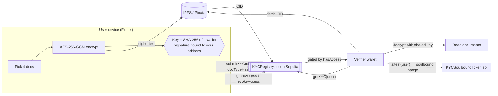

# DeKYC - Self-Sovereign KYC on Ethereum

> Encrypt your KYC documents on-device, pin the ciphertext to IPFS, store only a
> pointer on-chain, and grant banks **time-boxed, revocable** access from your
> wallet - no central database, no repeated uploads, no custodian who can leak
> your identity.


---

## What it does

Today, every bank and exchange asks you to upload the same ID documents, and
each one stores its own copy - so a single breach anywhere leaks your identity.
DeKYC flips that around: you encrypt your documents **on your own device**, pin
the encrypted blob to IPFS, and write only a pointer to it on the Ethereum
Sepolia testnet. Nobody can read anything without a key that never leaves your
device.

When a bank needs to verify you, you sign one transaction granting that specific
wallet address access for a fixed window, and you can revoke it at any moment.
After a verifier approves you, they can mint you a **non-transferable badge**
(ERC-5192 "soulbound" token) that any future relying party can check - so being
verified once is reusable, without re-uploading anything.

> **This is a working testnet demo, not a production identity system.** It runs
> on Sepolia only, and several parts are deliberately simplified. See
> [Current limitations](#current-limitations) - please read that section before
> judging the security model.

---

## Architecture



Two actors, two contracts:

- **Individual** encrypts Aadhaar (front/back), PAN and photo **on-device**, pins
  the ciphertext to IPFS, and writes the resulting CID to `KYCRegistry`.
- **Verifier** (bank / exchange / employer) asks the user for access. The user
  signs `grantAccess(verifier, expiresAt)`, which is pinned to the current
  record version. The verifier can then call `getKYC(user)`, fetch the CID, and
  decrypt it with the key the user wrapped to their transport public key.
- **Reusable proof** - after approving a user, a verifier mints a
  **non-transferable Soulbound Token** (`KYCSoulboundToken`, ERC-5192) to the
  user's wallet. Any future relying party can read `isVerifiedBy(issuer, user)`
  and trust an existing attestation instead of re-running KYC.

### Contracts (Sepolia)

Both are verified on Etherscan, and their on-chain bytecode matches the sources
in this repo - run `npm run check:sepolia` in `contracts/` to confirm.

| Contract | Address |
|---|---|
| `KYCRegistry` | [`0xb6d9b6e434cE719e6Aec0f7Fc39303E41e2ce6fe`](https://sepolia.etherscan.io/address/0xb6d9b6e434cE719e6Aec0f7Fc39303E41e2ce6fe#code) |
| `KYCSoulboundToken` (ERC-5192) | [`0x348a24009FC34063480b78FD639CF5D7e4Cb59b2`](https://sepolia.etherscan.io/address/0x348a24009FC34063480b78FD639CF5D7e4Cb59b2#code) |

`lib/config/contract_address.dart` is generated by the deploy script - it is the
single source of truth for what the app talks to.

### Who gives what to whom

The most confusing part of DeKYC is that **there is no on-chain "request"**. A
verifier cannot pull anything - nothing happens until the *user* grants. And two
separate things have to change hands, each unlocking a different half:

| The verifier sends the user | The user does with it | It unlocks |
|---|---|---|
| Their **wallet address** (`0x…`, 42 chars) | Manage Access → Add → **Grant** (an on-chain transaction) | The **pointer** - they can now find the encrypted file |
| Their **wrapping key** (`02…`/`03…`, 66 chars) | Manage Access → 🔐 → sends back a wrapped blob | The **documents** - they can now decrypt it |

Both values sit together at the top of the verifier's **Verify** screen, under
*"Send these to the user first"* - reachable before any grant exists, because
the user cannot grant or wrap without them.

Neither alone is enough. Address only and the verifier reaches a file they
cannot read; wrapped key only and they can read a file they cannot find. Both
values are public and safe to send in the clear - and so is the wrapped blob,
because it is locked to that one verifier.

The raw 64-character document key is the legacy path. It is **not** what you
send: it works for anyone who sees it, and revoking on-chain does not take it
back. The app labels it accordingly.

This is exactly what the in-app **How to use it** guide walks through, from
whichever side you are on.

### On-chain vs. off-chain split

| Stored on-chain (`KYCRegistry`) | Stored off-chain (IPFS) | Never stored anywhere |
|---|---|---|
| IPFS CID (string) | The encrypted document bundle | Plaintext documents |
| `docTypeHash` (bytes32) | - | The AES key |
| `submittedAt` timestamp | - | The wallet private key |
| Record version (bumped per upload) | - | The verifier's ECIES private key |
| Per-(user, verifier) expiry + granted version | - | - |

**Why this split?** Documents are large, private, and must never be public - so
they live encrypted off-chain. The chain holds only a tamper-evident *pointer*
plus an *access-control table*, which is exactly the part that benefits from
being decentralized and outside any single company's control. The wallet address
**is** the identity; there are no usernames and no passwords.

---

## Features

- **On-device AES-256-GCM encryption** - documents are encrypted before anything
  leaves the device. Native WebCrypto (`crypto.subtle`) on web so the UI never
  blocks; PointyCastle elsewhere. Both produce an identical `nonce ‖ ciphertext ‖ tag`
  layout, pinned by a published NIST/McGrew-Viega known-answer vector in the tests.
- **Wallet-derived keys** - the AES key is the SHA-256 of a wallet signature over
  a message bound to your address. Nothing to store, nothing to back up beyond
  your seed phrase. The signature is strictly validated (65 bytes, canonical `v`)
  so a malformed wallet response can never yield a predictable key.
- **Wallet-native auth** - Sign-In-with-Ethereum style. A signed nonce proves key
  control; the signature is verified client-side by ECDSA recovery.
- **Role-based UI** - sign in as **Individual** or **Verifier**; the role is
  inside the signed message and gates every action.
- **Time-boxed, revocable access** - `grantAccess(verifier, expiresAt)` and
  `revokeAccess(verifier)`. Access lapses automatically at `expiresAt`.
- **Consent is bound to a specific bundle** - every submission bumps a record
  version and grants are pinned to it, so re-uploading **invalidates outstanding
  grants**. A verifier who was shown your Aadhaar and PAN cannot silently start
  reading a later bundle that also contains your passport; you have to grant
  again, deliberately.
- **ECIES key wrapping** - the verifier publishes an in-app transport public
  key and the user encrypts the document key *to it* (secp256k1 ECDH → HKDF →
  AES-256-GCM), so the secret that crosses the channel is useless to anyone
  else. Raw-key sharing is still available but is the marked, discouraged path.
- **Optional pinning proxy** - a small dependency-free Node service (`proxy/`)
  holds the Pinata JWT server-side so it is never shipped to the browser.
- **Reusable soulbound proof** - ERC-5192 badges that can be minted, renewed
  after expiry and revoked, but never transferred **or approved for transfer**.
  Each badge pins its own metadata document, so `tokenURI` resolves.
- **Real transaction confirmation** - every on-chain action waits for the receipt
  and checks it did not revert before the UI claims success.
- **The guest list lives on-chain** - `KYCRegistry` keeps each user's list of
  granted verifiers and exposes it via a paged `grantsOf`, so "who can see my
  documents?" is answerable from contract state alone. No indexer, no backend,
  no device storage: open the app on a new machine and your list is there. One
  batched call returns every row with its live status already resolved, and
  `forgetVerifier` prunes an entry - refusing while the grant is still live, so
  tidying up can never be mistaken for revoking.
- **On-chain access status** - Manage Access reads the live expiry *and* grant
  version from the chain, and distinguishes *expired* from *lapsed because you
  re-uploaded*.
- **Paged badge counting** - the client pages `validBadgeCountRange` so a
  subject spammed with badges cannot make the count exceed an `eth_call` gas cap.
- **Dark/light design system** - a MetaMask-inspired wallet aesthetic, dark by
  default, with a persisted toggle.
- **182 tests** - 56 Solidity (Hardhat) + 126 Dart/Flutter (plus a live Sepolia integration test, skipped by default).

---

## Authentication, sessions & roles

DeKYC has **no passwords and no server-side accounts**:

1. At login you pick a **role**: **Individual** or **Verifier**. The dashboard
   adapts to it.
2. The app builds a human-readable challenge containing your address, role, a
   random nonce and an expiry, and asks the wallet to `personal_sign` it (free,
   no transaction).
3. The signature is **verified client-side** by ECDSA public-key recovery
   (EIP-191) and must recover to the connected address, otherwise sign-in is
   rejected. Merely *listing* an account proves nothing; signing proves key
   control *now*.

| Property | Mechanism |
|---|---|
| Expiry | 24 h - after that a fresh signature is required |
| Account binding | Switching accounts in an **injected** wallet (MetaMask on web) invalidates the session instantly. Over WalletConnect there is no account-change listener, so the session persists until it expires or you sign out. |
| Tamper evidence | On restore, the stored signature is re-verified against the reconstructed message; editing address/role/expiry in storage breaks it |
| Storage | `flutter_secure_storage` |
| Sign-out | Clears the session and disconnects the wallet |

Role gates: submitting KYC requires an **Individual** session; verifier mode
requires a **Verifier** session. Switch any time via Dashboard → **Switch role**.

---

## Threat model

A STRIDE-style pass. Each threat lists the **shipped** mitigation (file in
parentheses). Items that are *not* mitigated are in
[Current limitations](#current-limitations) instead - nothing in this table is
aspirational.

| Threat | Category | Mitigation |
|---|---|---|
| Fake login - UI shows an address the user doesn't control | Spoofing | Sign-in requires a fresh `personal_sign` over a nonce, verified client-side by ECDSA recovery against the connected address (`auth_service.dart`) |
| Stored-session tampering (edit role/expiry in storage) | Tampering | On restore the signature is re-verified against the reconstructed message - any field edit breaks it (`auth_service.dart`) |
| Stale session lives forever | Elevation | 24 h expiry forces a periodic re-sign (`auth_service.dart`) |
| Role confusion - verifier acts as user or vice-versa | Elevation | The role is *inside* the signed message; UI actions are role-gated |
| Transaction sent on the wrong network | Tampering | Injected path: `eth_chainId` is checked before every transaction and **fails closed** - if the chain cannot be read, the transaction is refused. WalletConnect path: the session is rejected unless it grants a Sepolia account, and every request is scoped to `eip155:11155111` (`wallet_service.dart`) |
| A reverted transaction shown as success | Integrity | Every on-chain action polls for the receipt and checks `status` before the UI claims it worked (`kyc_flow_service.dart`) |
| Wallet returns a malformed signature → predictable key | Info. disclosure | Key derivation requires a canonical 65-byte signature and rejects empty/short/odd/non-hex/all-zero input, so a `"0x"` response can never yield `sha256("")` (`encryption_service.dart`) |
| Same account, different wallet → unreadable bundle | Availability | The `v` byte is canonicalised to 27/28 before hashing, so wallet-specific `v` encodings derive the same key (`encryption_service.dart`) |
| Document bundle tampering on IPFS/gateway | Tampering | AES-256-GCM auth tag - decryption throws on any modified byte (`encryption_service.dart`) |
| Server/database breach | Info. disclosure | No server, no database - nothing to breach |
| Curious IPFS gateway reads documents | Info. disclosure | Gateways only ever see ciphertext |
| Unauthorized on-chain reads | Info. disclosure | `getKYC` and `getDocTypeHash` revert unless the caller is the user or holds an unexpired grant (`KYCRegistry.sol`) |
| A re-upload silently widens what an existing verifier can see | Elevation | Grants are pinned to the record version they were issued against; `submitKYC` bumps it, which lapses every outstanding grant until the user re-grants (`KYCRegistry.sol`) |
| The document key is intercepted in transit to the verifier | Info. disclosure | The key is wrapped to the verifier's transport public key (ECIES over secp256k1, HKDF-SHA256, AES-256-GCM) with both public keys bound into the KDF salt, so the blob cannot be read by a third party or replayed to a different verifier (`key_wrap_service.dart`) |
| The Pinata JWT is published by a web deployment | Info. disclosure | Optional: point `PINATA_PROXY_URL` at the bundled proxy, which holds the credential server-side (`proxy/`). Without it the JWT still ships - see Current limitations |
| Rogue contract admin | Elevation | No admin escape hatch - `KYCRegistry` has zero `onlyOwner` functions; the owner cannot read, grant or revoke anyone's data |
| CID path-traversal / URL-injection (the CID is written by another wallet) | Tampering | `IpfsService.isValidCid` restricts the on-chain CID to the CID alphabet **before** it is interpolated into a gateway URL; validation strictly precedes the fetch |
| Hostile file upload (wrong type / oversized) | Tampering | Upload restricted to JPG/JPEG/PNG/PDF, 5 MB cap, extension re-validated after pick (`kycupload.dart`) |
| Malicious "document" → XSS in the verifier viewer | Code execution | Only `%PDF`-magic bytes reach the viewer; the blob's MIME is forced to `application/pdf` (`blob:` URLs use `Blob.type` as the authoritative Content-Type), the preview `<iframe>` sets `referrerpolicy=no-referrer`, and a strict CSP in `web/index.html` contains the surface (`doc_view_web.dart`) |
| Soulbound badge listed on a marketplace | Spoofing | `approve` and `setApprovalForAll` revert, not just transfers - a locked token never advertises transfer authority (ERC-5192 conformance) |
| Inflated / expired "verified" count | Data integrity | `validBadgeCount` counts only unrevoked **and** unexpired badges, deduped per issuer; RPC failures surface as errors rather than silently falling back to an over-counting `balanceOf` |
| Splash-screen denial via wedged storage backend | DoS | Session-restore read is capped, then treated as signed-out (`auth_service.dart`) |

---

## Run locally

### 1) Contracts (Node 20+)

```bash
cd contracts
npm install
cp .env.example .env        # then fill in your own values
npx hardhat test            # 56 passing
```

Deploy your own copy (optional - the app already points at a live deployment):

```bash
npm run deploy:sepolia
```

The deploy script prints both addresses, writes them to
`lib/config/contract_address.dart`, and copies both ABIs into
`assets/contracts/` - the Flutter app picks all of it up automatically.

Verify the sources on Etherscan, then confirm the live bytecode still matches
this repo:

```bash
npm run verify:sepolia <DEPLOYED_ADDRESS>
```

```bash
npm run check:sepolia
```

> ⚠️ `e2e:sepolia` submits KYC **from the deployer key**. If that is also the
> account you use in the app, it will overwrite your real record with a test
> bundle encrypted under a throwaway key, which the app can then never decrypt.
> The script refuses to run when it detects a record uploaded from the UI;
> override with `E2E_OVERWRITE=1` only if you mean it, and re-upload afterwards.
> Better: give the script its own `DEPLOYER_PRIVATE_KEY`.

Finally, `npm run e2e:sepolia` walks the whole path against the **live**
contracts - encrypt → pin to Pinata → `submitKYC` → read as owner → confirm an
ungranted verifier is refused → `grantAccess` → read as the verifier → fetch from
the gateway and decrypt → tamper-check → `revokeAccess` → confirm the read is
refused again → mint a soulbound badge and confirm `approve`/`transferFrom`
revert. It costs a little Sepolia ETH and one small IPFS pin.

It runs every write as a **throwaway wallet** funded from the deployer for that
run, and sweeps the remainder back afterwards. That isolation matters:
`submitKYC` overwrites the signing account's record, so an earlier version that
ran as the deployer silently replaced a real KYC record with a bundle encrypted
under a discarded test key - which surfaced much later, on the verifier's
screen, as "the key opened correctly, but it does not decrypt this bundle".

### 2) Flutter app (Flutter 3.29+ / Dart 3.7+)

```bash
cp .env.example .env        # then fill in your own values
flutter pub get
flutter test                # 126 passing
flutter run -d chrome
```

Web is the best-supported target: it detects the MetaMask extension and offers
one-click connect. On mobile the app falls back to a WalletConnect QR code.

### 3) Pinning proxy (optional locally, required for a web deployment)

Flutter bundles `.env` as an app asset, so a `flutter build web` deployment
serves your Pinata JWT at `/assets/.env` to anyone who asks. Run the bundled
proxy to keep the credential server-side:

```bash
PINATA_JWT=your_jwt_here node proxy/server.js
```

Then add `PINATA_PROXY_URL=http://localhost:8787/pin` to the root `.env` - the
app will use the proxy and stop reading the JWT entirely. See
[`proxy/README.md`](proxy/README.md); it is a reference implementation with no
authentication, so add some before exposing it.

### 4) Demo flow

You need **two** wallet accounts - one acting as the user, one as the verifier.

1. **Sign in** - pick **Individual**, connect the wallet (auto-switching to
   Sepolia), and sign one free challenge. Your address is your identity; the
   session silently restores next launch (24 h).
2. **Upload KYC** - Dashboard → **Upload**. Pick Aadhaar front/back, PAN and a
   photo. The app encrypts them, pins the ciphertext to IPFS, asks your wallet to
   sign `submitKYC`, then **waits for the receipt**. The done screen shows the tx
   hash with an Etherscan link.
3. **Copy your wallet address** - this is the "user" address.
4. **Become the verifier** - Dashboard → **Switch role** → **Verifier** (signs a
   new challenge), then switch to your *second* wallet account. Tap **Verify**,
   paste the user's address and **Check Access Status** → *Pending*.
5. **Verifier shares their wrapping key** - on **View Documents** the verifier
   sees a *wrapping key* (a public key). Copy it to the user. It is safe to send
   in the clear.
6. **Back to the user** - switch role to **Individual** again, then Dashboard →
   **Access**. Add the verifier's address, tap **Grant** (signs `grantAccess`),
   then tap the 🔐 icon on that row to wrap your document key to the verifier's
   wrapping key. Send them the resulting blob - only they can unwrap it. The row
   now shows the real on-chain expiry.
7. **Verifier reads** - back in Verifier Mode, re-check status → *granted* →
   **View Documents** → paste the wrapped key → the bundle is fetched from IPFS,
   unwrapped, decrypted locally, and the documents render.
8. **Mint reusable proof** - the verifier taps **Mark as Verified (mint Soulbound
   proof)**, signing `attest(user, …)`. Metadata for that specific attestation is
   pinned to IPFS and a non-transferable ERC-5192 badge lands in the user's wallet.
9. **Reuse** - the user opens Dashboard → **Status** and sees their verification
   badge count, labelled per-issuer rather than as a trust score.
10. **Revoke** - the user taps **Revoke**; the verifier's next `getKYC` reverts.
11. **See consent binding** - upload a new bundle, then look at Manage Access:
    the row now reads *"Lapsed - you re-uploaded since granting"*, and the
    verifier's `getKYC` reverts until you grant again.

---

## Environment variables

### Root `.env` (Flutter app)

| Variable | Purpose | Required? |
|---|---|---|
| `SEPOLIA_RPC_URL` | Sepolia JSON-RPC endpoint (Alchemy/Infura). Used by web3dart for all read calls and receipt polling. | **Yes** - on-chain status is unavailable without it |
| `PINATA_PROXY_URL` | URL of the bundled pinning proxy (`proxy/`), which holds the Pinata JWT server-side. When set, `PINATA_JWT` is ignored by the app. | No, but **required for any web deployment** - otherwise the JWT is public |
| `PINATA_JWT` | Pinata API token used to pin encrypted bundles to IPFS. Local development only. | **Yes**, unless `PINATA_PROXY_URL` is set. Not needed to browse or read |
| `PINATA_GATEWAY` | Dedicated Pinata gateway host (e.g. `your-name.mypinata.cloud`). | No - defaults to `gateway.pinata.cloud` |
| `WALLETCONNECT_PROJECT_ID` | Reown/WalletConnect Cloud project id, for the mobile QR flow. | No - only for the WalletConnect path; the injected MetaMask path works without it |

### `contracts/.env` (Hardhat)

| Variable | Purpose | Required? |
|---|---|---|
| `SEPOLIA_RPC_URL` | Sepolia RPC endpoint used to deploy and to run `check:sepolia`. | Only to deploy/verify - `npx hardhat test` runs fully offline |
| `DEPLOYER_PRIVATE_KEY` | Private key of a **throwaway** test wallet holding only Sepolia ETH. | Only to deploy |
| `ETHERSCAN_API_KEY` | Etherscan V2 API key, for source verification. | Only for `verify:sepolia` |

Both `.env` files are gitignored. The committed `.env.example` files contain
placeholders only.

---

## Current limitations

Honest list of what this demo does **not** do. These are design simplifications,
not oversights, and each has a known production fix.

- **Testnet only.** Sepolia. There is no mainnet RPC URL or deploy path anywhere
  in the repo, and the contracts have **not been professionally audited**.
- **The full UI has not been driven end-to-end by an automated test.** The
  contract + IPFS + crypto path is proven live on Sepolia by
  `npm run e2e:sepolia`, and the widget layer has 87 tests, but the browser flow
  with real wallet popups and two accounts has not been exercised automatically -
  wallet signing needs a human. Do one manual pass before relying on it.
- **Key wrapping still needs an out-of-band exchange.** ECIES means the blob that
  travels is safe, but the user still has to *obtain* the verifier's transport
  public key through some channel, and nothing authenticates that key. A
  man-in-the-middle who substitutes their own public key can read the bundle.
  Binding the transport key to the verifier's wallet (a signature over it, or
  publishing it on-chain) is the missing half.
- **A verifier who has decrypted a bundle keeps that copy.** Revocation stops
  *future* reads; it cannot un-see what was already downloaded. That is inherent
  to handing someone a document, not a bug.
- **The transport key is not rotated per grant.** One keypair per verifier
  device, reused across users.
- **The Pinata JWT ships inside the web build unless you run the proxy.** Flutter
  bundles `.env` as an app asset, so on a `flutter build web` deployment any
  visitor can fetch `/assets/.env` - this is verified, not theoretical. Set
  `PINATA_PROXY_URL` and run `proxy/server.js` to avoid it. The bundled proxy is
  a **reference**: it has no authentication, so add some before exposing it.
- **Signature phishing is not prevented.** `personal_sign` has no origin/domain
  separator, so a hostile site can request the same key-derivation signature. The
  message text makes the consequence obvious in the wallet prompt, but only
  EIP-712 typed data with a domain separator would actually bind the derivation
  to this app.
- **Attestation is permissionless.** Anyone can mint a badge to anyone. The badge
  count is therefore a **count, not a trust score** - relying parties must check
  the *issuer* via `isVerifiedBy`. There is no issuer registry or allowlist.
- **A subject cannot burn an unwanted badge.** Only the issuer can revoke. A
  spammer can attach badges to any address permanently.
- **Wallet key loss = document loss.** The encryption key is derived from a wallet
  signature. Lose the wallet, lose the documents. That is the cost of having no
  custodian.
- **Metadata is public.** The chain reveals *that* an address submitted KYC and
  *which* verifiers it granted - not the contents, but the graph. Badge metadata
  pinned to IPFS is public too, and deliberately carries only the two addresses
  and the validity window.
- **No account-change detection over WalletConnect.** Switching accounts only
  invalidates the session on the injected (browser-extension) path.
- **Inline PDF preview is web-only.** On desktop/mobile the verifier decrypts and
  opens PDFs in the system viewer rather than inline.
- **`docTypeHash` is fixed.** Every submission uses the same hard-coded
  Aadhaar/PAN/photo document set.
- **Your guest list is public.** `grantsOf` is a public view, exactly like the
  `AccessGranted` events it mirrors - the chain already revealed which verifiers
  you granted, so this exposes nothing new, but it does not hide it either.
  Hiding the access graph would need commitments or a privacy L2, not a storage
  change.
- **A user always has access to their own record.** `hasAccess(user, user)` is
  true by design. Testing with a single wallet for both roles therefore looks
  like "any verifier can read anyone" - it is not. Use two accounts; Verifier
  Mode now labels the self-access case explicitly.
- **The shipped CSP allows `'unsafe-inline'` scripts.** Flutter's debug bootstrap
  requires it; without it `flutter run -d chrome` renders a blank page. Release
  builds do not need it - for production, build with `flutter build web --csp`
  and serve a strict CSP as a response header instead (`web/index.html` explains
  this inline).

---

## Repository layout

```
de_kyc/
├── contracts/                       # Hardhat + TypeScript smart-contract project
│   ├── contracts/
│   │   ├── KYCRegistry.sol          # pointer + access-control table
│   │   └── KYCSoulboundToken.sol    # ERC-5192 reusable attestation badge
│   ├── scripts/
│   │   ├── deploy.ts                # deploys both, writes addresses + ABIs into the app
│   │   ├── verify-deployment.ts     # asserts live bytecode == current sources
│   │   └── e2e-sepolia.ts           # walks the full path against the live contracts
│   ├── test/                        # 56 tests across both contracts
│   └── .env.example                 # SEPOLIA_RPC_URL / DEPLOYER_PRIVATE_KEY / ETHERSCAN_API_KEY
├── proxy/                           # optional pinning proxy - keeps the Pinata JWT server-side
│   ├── server.js                    # dependency-free Node service
│   └── README.md
├── lib/
│   ├── config/                      # chain_config, env accessor, contract_address (generated)
│   ├── theme/                       # design system - dark by default, light variant
│   ├── services/                    # wallet, auth, ipfs, encryption, contracts, flow
│   │   ├── key_wrap_service.dart    # ECIES: encrypt the document key TO a verifier
│   │   ├── transport_key_store.dart # the verifier's ECIES keypair, in secure storage
│   │   ├── crypto/                  # aes_gcm_io (PointyCastle) | aes_gcm_web (WebCrypto)
│   │   └── doc_view/                # PDF preview: iframe on web, system viewer elsewhere
│   └── screens/                     # onboarding, auth, upload wizard, status, verifier mode
├── assets/contracts/                # KYCRegistry + KYCSoulboundToken ABIs (generated)
├── test/                            # 122 Dart/Flutter tests
└── .env.example                     # SEPOLIA_RPC_URL / PINATA_PROXY_URL / PINATA_JWT / …
```

---

## Screens

| Screen | Purpose |
|---|---|
| Onboarding | Logo mark + value prop → Get Started (role login) / tour |
| How DeKYC works | Swipeable 7-step tour of the concepts |
| How to use it | Role-aware 6-step tour of the actual hand-off (Individual / Verifier) |
| Login | Role-based wallet auth (Individual / Verifier) with signed challenge |
| Connect Wallet | One-click MetaMask on web, WalletConnect QR on mobile |
| Upload KYC | 4-step wizard → encrypt → IPFS → on-chain, live progress |
| KYC Done | Tx hash, IPFS CID, Etherscan link |
| Dashboard | Wallet chip + identity hero + role-aware action tiles |
| KYC Status | Submission state + verification badge count |
| Manage Access | Grant / revoke verifiers with live on-chain expiry and consent-version status, wrap your key to a verifier |
| Verifier Mode | Check access for a user address, read documents |
| KYC Documents | Decrypt & view docs, mint soulbound Verified badge |
| Profile | Address, network, contract links, key tools, disconnect |

_Screenshots coming soon._

---

## Tech stack

**Contracts:** Solidity 0.8.26 (Cancun), OpenZeppelin `Ownable` + `ERC721`,
ERC-5192 soulbound tokens, Hardhat, ethers v6,
`@nomicfoundation/hardhat-toolbox`, TypeScript.

**App:** Flutter, web3dart, Reown (WalletConnect v2), Pinata/IPFS, AES-256-GCM
(native **WebCrypto** `crypto.subtle` on web - non-blocking - and PointyCastle
off-web), ECIES over secp256k1 (PointyCastle ECDH + HKDF-SHA256),
`flutter_dotenv`, `flutter_secure_storage`.

**Proxy (optional):** plain Node 20+, zero dependencies.

**Network:** Ethereum **Sepolia** testnet only.

---

## Security & secrets

- All secrets live in **gitignored** `.env` files. The committed `.env.example`
  files hold placeholders only. No private keys, JWTs or RPC keys are committed.
- **Sepolia only** - there is no mainnet RPC URL or deploy path anywhere.
- Use a **fresh** test wallet for `DEPLOYER_PRIVATE_KEY`; never one with mainnet
  funds.
- **A web build serves `.env` at `/assets/.env`.** Flutter bundles it as an app
  asset. Run the [pinning proxy](proxy/README.md) and set `PINATA_PROXY_URL` so
  the JWT never reaches the browser.
- See [Current limitations](#current-limitations) for the weaknesses this demo
  knowingly accepts.

---

## License

MIT - see [`LICENSE`](LICENSE). © 2026 Priyanshu Ashish Maniar.

## Author

**Priyanshu Ashish Maniar** - [github.com/priyanshumaniar](https://github.com/priyanshumaniar)
