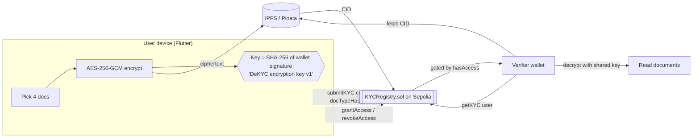

# DeKYC — Self-Sovereign KYC on Ethereum

> Upload your KYC once, encrypted, to IPFS. Store only a pointer on-chain. Grant
> banks and exchanges **time-boxed, revocable** read access from your wallet —
> no central database, no repeated document uploads, no custodian who can leak
> your identity.


---

## Architecture



Two actors, two contracts:

- **Individual** encrypts Aadhaar (front/back), PAN and photo **on-device**, pins
  the ciphertext to IPFS, and writes the resulting CID to `KYCRegistry`.
- **Verifier** (bank / exchange / employer) asks for access by wallet address.
  The user signs `grantAccess(verifier, expiresAt)`. The verifier can then call
  `getKYC(user)`, fetch the CID, and decrypt.
- **Reusable proof** — after approving a user, a verifier mints a
  **non-transferable Soulbound Token** (`KYCSoulboundToken`, ERC-5192) to the
  user's wallet. Any future relying party can read `isVerifiedBy(issuer, user)`
  (or the user's badge count) and trust an existing attestation instead of
  re-running KYC. *Verify once, reuse everywhere.*

### Contracts (Sepolia)

| Contract | Address |
|---|---|
| `KYCRegistry` | [`0xe5728Fca8072a4Dd93408BE2Aa457d723E99C777`](https://sepolia.etherscan.io/address/0xe5728Fca8072a4Dd93408BE2Aa457d723E99C777#code) |
| `KYCSoulboundToken` (ERC-5192) | [`0x4e2273dd8c64b3c943757880AfEdE64C3C65AD99`](https://sepolia.etherscan.io/address/0x4e2273dd8c64b3c943757880AfEdE64C3C65AD99#code) |

### On-chain vs. off-chain split

| Stored on-chain (`KYCRegistry`) | Stored off-chain (IPFS) | Never stored anywhere |
|---|---|---|
| IPFS CID (string) | The encrypted document bundle | Plaintext documents |
| `docTypeHash` (bytes32) | — | The AES key |
| `submittedAt` timestamp | — | The wallet private key |
| Per-(user, verifier) expiry table | — | — |

**Why this split?** Documents are large, private, and must never be public —
so they live encrypted off-chain. The chain holds only a tamper-evident
*pointer* plus an *access-control table*, which is exactly the part that
benefits from being decentralized, auditable, and outside any single company's
control. The wallet address **is** the identity; there are no usernames.

---

## Authentication, sessions & roles

DeKYC has **no passwords and no server-side accounts** — authentication is
wallet-native, Sign-In-with-Ethereum style:

1. At login you pick a **role**: **Individual** (submit KYC, manage access,
   collect badges) or **Verifier** (check access, read documents, mint
   badges). The dashboard adapts to the role.
2. The app builds a human-readable challenge containing your address, role,
   a random nonce, and an expiry, and asks the wallet to `personal_sign` it
   (free, no transaction).
3. The signature is **verified client-side** by ECDSA public-key recovery
   (EIP-191) — it must recover to the connected address, otherwise sign-in is
   rejected. Merely *listing* an account proves nothing; signing proves key
   control *now*.

**Session properties** (`lib/services/auth_service.dart`):

| Property | Mechanism |
|---|---|
| Expiry | 24 h — after that a fresh signature is required |
| Account binding | Switching MetaMask accounts invalidates the session instantly |
| Tamper evidence | On restore, the stored signature is re-verified against the reconstructed message; editing address/role/expiry in storage breaks it |
| Storage | `flutter_secure_storage` (browser: encrypted local storage) |
| Sign-out | Clears the session and disconnects the wallet |

Role gates: submitting KYC requires an **Individual** session; verifier mode
requires a **Verifier** session. Switch any time via Dashboard → Switch role
(one new signature).

---

## Threat model

A STRIDE-style pass over the app. Each threat is listed with the shipped
mitigation (file in parentheses).

| Threat | Category | Mitigation |
|---|---|---|
| Fake login — UI shows an address the user doesn't control | Spoofing | Sign-in requires a fresh `personal_sign` over a nonce; signature is verified client-side by ECDSA recovery and must match the connected address (`auth_service.dart`) |
| Session replay / reuse on another account | Spoofing | Session is bound to the signing address; a MetaMask account switch invalidates it instantly (`auth_service.dart`) |
| Stored-session tampering (edit role/expiry in storage) | Tampering | On restore the signature is re-verified against the reconstructed message — any field edit breaks it and the session is discarded (`auth_service.dart`) |
| Stale session lives forever | Elevation | 24 h expiry forces a periodic re-sign (`auth_service.dart`) |
| Role confusion — verifier acts as user or vice-versa | Elevation | The role is *inside* the signed message; UI actions are role-gated (upload → Individual, verify → Verifier) |
| Transaction on the wrong network (user switched MetaMask to mainnet) | Tampering / financial | `eth_chainId` is checked before EVERY transaction; auto-switch back to Sepolia or abort with a clear error (`wallet_service.dart`) |
| Document bundle tampering on IPFS/gateway | Tampering | AES-256-GCM auth tag — decryption throws on any modified byte (`encryption_service.dart`) |
| Server/database breach | Info. disclosure | No server, no database — nothing to breach |
| Curious IPFS gateway reads documents | Info. disclosure | Gateways only ever see ciphertext |
| Unauthorized on-chain reads | Info. disclosure | `getKYC` reverts unless caller is the user or holds an unexpired grant (`KYCRegistry.sol`) |
| Rogue contract admin | Elevation | No admin escape hatch — the owner cannot read, grant or revoke anyone's data (enforced by unit test) |
| Hostile file upload (wrong type / oversized) | Tampering | Upload restricted to JPG/JPEG/PNG/PDF, 5 MB cap, extension re-validated after pick (`kycupload.dart`) |
| Splash-screen denial via wedged storage backend | DoS | Session-restore read is capped at 4 s, then treated as signed-out (`auth_service.dart`) |
| CID path-traversal / URL-injection (CID is set by another wallet) | Tampering | `IpfsService.isValidCid` restricts the on-chain CID to the CID alphabet before it is interpolated into a gateway URL (`ipfs_service.dart`) |
| Inflated / expired "verified" count | Data integrity | `validBadgeCount` counts only unrevoked + unexpired badges; the UI presents the count as informational, not vetted trust — relying parties check the **issuer** per badge (`KYCSoulboundToken.sol`) |
| Permissionless attestation spam (anyone can mint a badge) | Spoofing | By design (decentralized issuers); never shown as a trust score. Trust is decided per issuer via `isVerifiedBy`. `validBadgeCount` is bounded to *distinct* issuers, so revoke/re-attest loops can't gas-grief it. **Known gap:** a subject cannot self-burn an unwanted soulbound badge (only the issuer can revoke). Production: an issuer registry/allowlist + subject opt-out |
| Malicious "document" → XSS in the verifier viewer | Code execution | Only `%PDF`-magic bytes reach the viewer; the blob's MIME is forced to `application/pdf` (`blob:` URLs use `Blob.type` as the authoritative Content-Type — no MIME sniffing), so a HTML/JS polyglot renders as a failed PDF, not as script. The preview `<iframe>` sets `referrerpolicy=no-referrer`, and a strict CSP (`object-src 'none'`, `frame-src 'self' blob:`, `base-uri 'self'`) in `web/index.html` contains the surface as defence-in-depth (`doc_view_web.dart`) |
| Pinata JWT readable in the web bundle | Info. disclosure | **Open (web):** a client cannot hold an API secret. Production: pin via a backend proxy that issues short-lived scoped tokens (documented in `ipfs_service.dart`) |

**Defends against**

- **Server / database breach.** There is no central KYC database to steal. An
  attacker who owns the backend gains nothing — there is no backend that holds
  documents or keys.
- **Compromised IPFS gateway.** Gateways only ever see ciphertext. A malicious
  gateway can withhold or serve bytes, but cannot read documents (AES-256-GCM)
  and cannot forge them (the GCM auth tag fails on tampering → decryption throws).
- **Censorship / takedown.** The CID is content-addressed; anyone can re-pin the
  encrypted blob to any IPFS node and the on-chain pointer still resolves.
- **Unauthorized reads.** `getKYC` reverts unless the caller is the user or a
  verifier with an **unexpired** grant. Access lapses automatically at
  `expiresAt`; the user can `revokeAccess` at any time.
- **Rogue admin.** The contract has **no admin escape hatch** — the `Ownable`
  owner cannot read, grant, or revoke any user's data (enforced by a unit test).

**Does NOT defend against**

- **Wallet key loss = document loss.** The encryption key is derived from a
  wallet signature. Lose the wallet → you can never re-derive the key →
  the encrypted bundle is permanently unreadable. This is the cost of having no
  custodian. Back up your seed phrase.
- **Key-sharing trust.** In this demo the symmetric key is shared with a
  verifier out-of-band on grant. A verifier who keeps the key can read *future*
  re-uploads encrypted with the same key. **Production fix:** wrap the symmetric
  key to the verifier's public key (ECIES / `eth_getEncryptionPublicKey`) and
  rotate per grant, so revocation is cryptographic, not just on-chain.
- **Endpoint compromise.** Malware on the user's unlocked device can read
  plaintext while documents are being prepared. Standard mobile-security
  assumptions apply.
- **Metadata leakage.** The chain publicly reveals *that* an address submitted
  KYC and *which* verifiers it granted — not the contents, but the graph.

---

## Repository layout

```
de_kyc/
├── contracts/                  # Hardhat + TypeScript smart-contract project
│   ├── contracts/KYCRegistry.sol
│   ├── scripts/deploy.ts        # deploys + writes address/ABI into the app
│   ├── test/                    # 21 tests (KYCRegistry + KYCSoulboundToken)
│   ├── hardhat.config.ts
│   └── .env.example             # SEPOLIA_RPC_URL / DEPLOYER_PRIVATE_KEY / ETHERSCAN_API_KEY
├── lib/
│   ├── config/                  # chain_config.dart, contract_address.dart (generated)
│   ├── theme/                   # app_theme.dart — monochrome design system
│   ├── services/                # wallet (injected + WalletConnect) / ipfs / encryption / contracts / flow
│   └── screens/                 # onboarding, auth, upload wizard, status, verifier mode, profile
├── assets/contracts/KYCRegistry.abi.json   # consumed by web3dart (generated)
└── .env.example                 # SEPOLIA_RPC_URL / PINATA_JWT / WALLETCONNECT_PROJECT_ID
```

---

## Run locally

### 1) Contracts (Node 20+)

```bash
cd contracts
npm install                 # or: pnpm install
cp .env.example .env        # then fill SEPOLIA_RPC_URL, DEPLOYER_PRIVATE_KEY, ETHERSCAN_API_KEY
npx hardhat test            # 11 passing
npx hardhat run scripts/deploy.ts --network sepolia
```

The deploy script prints the contract address, writes it to
`lib/config/contract_address.dart`, and copies the ABI to
`assets/contracts/KYCRegistry.abi.json` — the Flutter app picks both up
automatically. Verify the source on Etherscan with:

```bash
npx hardhat verify --network sepolia <DEPLOYED_ADDRESS>
```

### 2) Flutter app (Flutter ≥ 3.7)

```bash
cp .env.example .env        # then fill SEPOLIA_RPC_URL, PINATA_JWT, WALLETCONNECT_PROJECT_ID
flutter pub get
flutter test                # encryption + contract-service unit tests
flutter run
```

### 3) Demo flow

1. **Sign in** — pick a role (Individual / Verifier), connect the wallet (on
   web the app detects the MetaMask extension and offers one-click connect,
   auto-switching to **Sepolia**; on mobile it falls back to a WalletConnect
   QR), then sign one free challenge message. Your address is your identity,
   and the session silently restores on the next launch (24 h validity).
2. **Upload KYC** — pick Aadhaar front/back, PAN, and a photo. The app encrypts
   them, pins the ciphertext to IPFS, and asks your wallet to sign `submitKYC`.
   The done screen shows the tx hash with a `sepolia.etherscan.io` link.
3. **Copy your wallet address** (this is the "user" address).
4. **Open as a verifier** — Dashboard → **Verifier Mode**. Connect a *second*
   wallet (the verifier). Paste the user's address and **Check Access Status** →
   it shows *Pending*.
5. **Switch back to the user** — Dashboard → **Manage Access**. Add the
   verifier's address, tap **Grant** (signs `grantAccess` on-chain), and tap
   **Reveal decryption key** to share the key with the verifier.
6. **Verifier reads** — back in Verifier Mode, re-check status → *granted* →
   **View Documents** → paste the key → the bundle is fetched from IPFS,
   decrypted locally, and the documents render.
7. **Mint reusable proof** — on the documents screen the verifier taps
   **Mark as Verified (mint Soulbound proof)**, signing `attest(user, …)`. A
   non-transferable ERC-5192 badge lands in the user's wallet.
8. **Reuse** — the user opens Dashboard → **KYC Status** and sees *Verified by N
   organizations*. Any other verifier can now trust the badge without a
   re-check.
9. **Revoke** — the user taps **Revoke** (access); the verifier's next `getKYC`
   reverts. A verifier can also revoke its badge via `revokeAttestation`.

---

## Screens

**Design system v2** (`lib/theme/app_theme.dart` + `lib/theme/components.dart`)
— a blockchain-wallet aesthetic inspired by MetaMask: near-black canvas, soft
dark cards, one violet accent, pill buttons, circular icon chips, account
pill, big hero type and action tiles. **Dark by default**, full light variant,
toggle in the Dashboard app bar and in Profile → Appearance (persisted).

| Screen | Purpose |
|---|---|
| Onboarding | Logo mark + value prop → Get Started (role login) / tour |
| User Guide | Fun, swipeable 7-step tour of the whole app (Dashboard → 🚀 card) |
| Login | Role-based wallet auth (Individual / Verifier) with signed challenge |
| Connect Wallet | One-click MetaMask on web, WalletConnect QR on mobile |
| Upload KYC | 4-step wizard → encrypt → IPFS → on-chain, live progress |
| KYC Done | Tx hash, IPFS CID, Etherscan link |
| Dashboard | Wallet chip + identity / verifier / account actions |
| KYC Status | Submission state + “Verified by N organizations” badges |
| Manage Access | Grant / revoke verifiers, reveal decryption key |
| Verifier Mode | Check access for a user address, read documents |
| KYC Documents | Decrypt & view docs, mint soulbound Verified badge |
| Profile | Address, network, contract links, key tools, disconnect |

> _Screenshots: run the app and capture — placeholders intentionally omitted._

---

## Tech stack

**Contracts:** Solidity 0.8.26 (Cancun), OpenZeppelin `Ownable` + `ERC721`,
ERC-5192 soulbound tokens, Hardhat, ethers v6,
`@nomicfoundation/hardhat-toolbox`, TypeScript.
**App:** Flutter, web3dart, Reown (WalletConnect v2), Pinata/IPFS,
AES-256-GCM (native **WebCrypto** `crypto.subtle` on web — non-blocking —
falling back to PointyCastle off-web), `flutter_dotenv`,
`flutter_secure_storage`.
**Network:** Ethereum **Sepolia** testnet only.

---

## Security & secrets

- All secrets live in **gitignored** `.env` files. The committed `.env.example`
  files hold placeholders only. No private keys, JWTs, or RPC keys are committed.
- **Sepolia only** — there is no mainnet RPC URL or deploy path anywhere.
- Use a **fresh** test wallet for `DEPLOYER_PRIVATE_KEY`; never one with mainnet
  funds.

## Changelog (goal iterations)

- **Iteration 1** — Wallet-native auth (SIWE-style signed challenge, verified
  client-side via ECDSA recovery), 24 h sessions in secure storage with
  tamper-evidence and account-switch invalidation, role-based login
  (Individual / Verifier) with a role-aware dashboard and per-action role
  gates. 22 unit/widget tests passing.
- **Iteration 2** — Fun user guide: a swipeable 7-step "How DeKYC works"
  tour (emoji, fun facts, zero jargon) linked from a 🚀 card at the top of
  the dashboard.
- **Iteration 3** — Security hardening: STRIDE threat table (above), plus a
  new chain guard — `eth_chainId` is verified before every transaction so a
  mid-session MetaMask network switch can never send a DeKYC transaction to
  the wrong chain.
- **Iteration 4 (fix)** — Squashed a layout crash on the **signed-out**
  dashboard: the sign-in banner's button sat in a `Row` while the theme makes
  buttons full-width, forcing an infinite width that blanked the page. Bounded
  the button and added a dashboard render test (under the real theme) so the
  signed-out path is now covered. 25 tests passing.
- **Iteration 5 (UI v2)** — Whole UI/UX rebuilt from scratch in a
  MetaMask-style wallet aesthetic: dark by default with a persisted light
  toggle, account pill, identity hero with live on-chain status, action
  tiles, circular icon rows, pill buttons. Removed dead weight (email signup
  screen, legacy confirmation screen); honest "guest list" copy in Manage
  Access. 26 tests passing, analyzer clean.
- **Iteration 6 (security pass)** — Full STRIDE re-audit. Fixed: the
  soulbound "verified count" now excludes expired/revoked badges
  (`validBadgeCount`) and the UI no longer presents it as vetted trust;
  on-chain CIDs are validated before use (`isValidCid`) to block
  path/URL-injection. Documented + remediated the architectural items (web
  JWT exposure → backend proxy; soft on-chain read gate → ECIES key
  wrapping). Confirmed clean: EIP-191 auth, AES-GCM, soulbound transfer
  block, PDF-viewer XSS surface. **54 tests** (30 Flutter + 24 Solidity).
  ⚠️ The `validBadgeCount` fix needs a contract **redeploy** to take effect
  on-chain (the app falls back to `balanceOf` until then).

## License

MIT — see [`LICENSE`](LICENSE).
